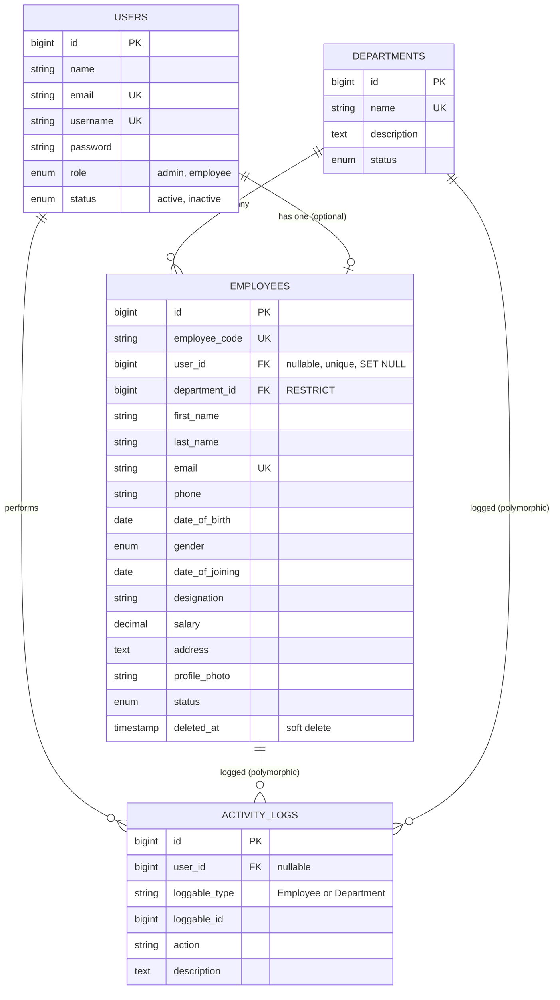

# Employee Management System


A secure, role-based web application for managing employees, departments and user accounts, built with **Laravel** and **MySQL**. It follows a real development process: MVC architecture, Form Request validation, authentication and authorization, a token-secured REST API, automated tests, Git branching and Agile (Jira) tracking.

---

## 1. Project Introduction

The Employee Management System (EMS) lets an organisation keep its people records in one place:

- **HR administrators** manage employees, departments and login accounts, and read reports.
- **Employees** sign in to see their own profile, update the details they are allowed to change, and see their department.

The project was built as a training assignment. Its goal is not only to create CRUD screens but to apply the full software development process: SDLC and Agile (Scrum board in Jira), Git feature-branch workflow with pull requests, MVC separation, PDO-backed prepared statements through Eloquent and the Query Builder, session authentication with authorization, validation on both client and server, a REST API, testing, security hardening, performance tuning and documentation.

**Objectives**

- Build a normalised MySQL database with real relationships (Department 1 to many Employees).
- Separate responsibilities clearly (routes, middleware, Form Requests, controllers, services, repositories, models, views).
- Protect every action with authentication and authorization, not only the menu.
- Provide a documented REST API that reuses the same rules as the web application.

---

## 2. Features

### Authentication and access control
- Login with **email or username**, "remember me", session regeneration on login and invalidation on logout.
- **Brute-force protection:** 5 failed attempts per minute for each username and IP address, with a clear "try again in N seconds" message.
- **Forgot and reset password** by emailed link (valid for 60 minutes, one request per minute).
- Inactive accounts cannot sign in, and an account deactivated while signed in is signed out on its next request.
- **Role-based access:** an `Admin` area and an `Employee` area, enforced by middleware, gates and policies. An employee who types an admin URL receives a **403** page.
- Custom error pages for 403, 404, 419 and 500.

### Employee management (Admin)
- Add, view, edit and deactivate employees with all required fields: employee code (generated, such as `EMP0001`), first and last name, email, phone, date of birth, gender, date of joining, department, designation, salary, address, profile photo, status, created and updated dates.
- **Search** (name, email, code), **filters** (department, status, gender), **sorting** (code, name, salary, joining date) and **pagination**.
- **Live search:** results update as you type, without reloading the page (AJAX with JSON).
- **Deactivate, restore and delete permanently.** Deactivating hides the employee and marks them inactive (a soft delete). A deactivated employee can be restored. Permanent deletion is admin-only and works only on deactivated employees.
- **Profile photo upload:** JPG or PNG, up to 2 MB, minimum 100 x 100 pixels. A default avatar is shown when there is no photo, and the old file is deleted when a photo is replaced or the employee is deleted permanently.
- Link an employee to a login account, and export the employee list to CSV.
- **Activity log:** every create, update, deactivation, restore and permanent delete is recorded and shown on the employee page.

### Department management (Admin)
- Add, edit, view, search and deactivate departments.
- Filters (has employees, has none, has inactive employees) and sorting by name or employee count.
- Per-department employee count, average and total salary, designation breakdown and activity log.
- The database refuses to delete a department that still has employees.

### User management (Admin)
- Add, edit, search and deactivate application users with a unique username and email, a role (admin or employee) and a status.
- Passwords are hashed (never stored in plain text). Leaving the password blank on edit keeps the current one.
- An admin cannot deactivate their own account.

### Dashboard and reports (Admin)
- Dashboard: total, active and inactive employees, number of departments, and employees by department.
- Seven reports built with the Query Builder: employees and salary by department (JOIN, GROUP BY, aggregates), departments above a size (HAVING), employees earning above their department average (subquery), top earners (WHERE IN), joiners per month, a raw parameterised query, and a paginated list of inactive employees.

### Employee self-service
- View own profile, update phone, address and photo, change password, and view department information.

### REST API
- Token-based (Laravel Sanctum) JSON API for employees, with consistent response structure, correct HTTP status codes, validation errors, rate limiting and role-aware access. See [API Documentation](#11-api-documentation).

### Security
- Password hashing, CSRF tokens on every form and AJAX call, output escaping in Blade, server-side validation (Form Requests), `$fillable` mass-assignment protection, prepared statements, secure file uploads, authorization checks (middleware, gates, policies), login throttling, security headers, and secrets kept in `.env`.

### Quality and tooling
- Form Requests, PHP enums, observers, policies, services and repositories, a custom config file (`config/ems.php`), a custom helper, audit logging, Laravel Pint code style (PSR-12), automated tests, and Composer and npm lock files.

---

## 3. Technologies Used

| Layer | Technology |
|---|---|
| Language | PHP 8.2+ |
| Framework | Laravel 12 |
| Database | MySQL or MariaDB (through XAMPP in development) |
| Data access | Eloquent ORM, Query Builder, PDO prepared statements |
| Views | Blade templates, Blade components |
| Front end | HTML5, CSS3, JavaScript (fetch, AJAX), Bootstrap 5 |
| Asset build | Vite, `laravel-vite-plugin`, npm |
| Authentication | Laravel session guard, Laravel Sanctum (API tokens) |
| Testing | PHPUnit (`php artisan test`), Postman for the API |
| Code quality | Laravel Pint (PSR-12) |
| Version control | Git, GitHub |
| Project management | Jira (Scrum board) |
| Server | Apache or Nginx, PHP-FPM, Supervisor (queue worker) |

---

## 4. Requirements

| Requirement | Version |
|---|---|
| PHP | 8.2 or newer, with extensions `mbstring`, `openssl`, `pdo_mysql`, `fileinfo`, `ctype`, `json`, `tokenizer`, `xml`, `curl` |
| Composer | 2.x |
| Node.js and npm | Node 20.19 or newer (or 22.12 or newer). Older Node versions fail to start Vite. |
| Database | MySQL 8 or MariaDB 10.4 or newer |
| Git | any recent version |
| Web server | `php artisan serve` for development, Apache or Nginx for deployment |
| Browser | a current version of Chrome, Edge or Firefox |

---

## 5. Installation Steps

```bash
# 1. Get the code
git clone https://github.com/Harish172005/Employee-Management-System.git
cd Employee-Management-System

# 2. Install PHP dependencies
composer install

# 3. Create your environment file and application key
cp .env.example .env            # Windows (cmd): copy .env.example .env
php artisan key:generate

# 4. Create the database (see section 6), then set DB_* in .env

# 5. Create the tables and sample data
php artisan migrate --seed

# 6. Make uploaded photos reachable from the browser
php artisan storage:link

# 7. Install and build front-end assets
npm install
npm run dev                     # keep this running while developing (or: npm run build)

# 8. Start the application (in a second terminal)
php artisan serve
```

Open **http://localhost:8000** and sign in with a default account:

| Role | Email | Username | Password |
|---|---|---|---|
| Admin | `admin@example.com` | `admin` | `password` |
| Employee | `employee@example.com` | `john` | `password` |

> These accounts are for local development only. Change or remove them before any real deployment.

**Windows notes**
- `php artisan storage:link` needs an Administrator terminal. If it fails, run `mklink /D public\storage ..\storage\app\public` from the project folder.
- Set `APP_URL` in `.env` to the exact address you browse (for example `http://localhost:8000`), otherwise uploaded photos show as broken images.

**If the page has no styling**, `npm run dev` is not running and `npm run build` has not been run. If you see "Vite manifest not found", run one of them.

---

## 6. Database Setup

### Option A (recommended): migrations and seeders
1. In phpMyAdmin (or the MySQL client) create an empty database named `employee_management_db` with collation `utf8mb4_unicode_ci`.
2. Put the connection details in `.env` (section 8).
3. Run:
   ```bash
   php artisan migrate --seed
   ```
   The seeders create 5 departments, the two default accounts, a demo employee linked to the `john` account, and 50 sample employees.

### Option B: import the SQL dump
Import `database.sql` (in the project root) through phpMyAdmin: select the database, choose **Import**, and pick the file.

### Useful commands
| Command | What it does |
|---|---|
| `php artisan migrate:status` | Shows which migrations have run |
| `php artisan migrate:rollback` | Undoes the last batch |
| `php artisan migrate:fresh --seed` | Drops every table, rebuilds, and reseeds (deletes all data) |
| `php artisan db:seed` | Runs the seeders only |

### Tables
| Table | Purpose |
|---|---|
| `users` | Login accounts: name, email, username, hashed password, role, status |
| `departments` | Department name, description, status |
| `employees` | Employee records, soft-deleted when deactivated |
| `activity_logs` | History of changes to employees and departments |
| `password_reset_tokens`, `sessions`, `cache`, `jobs`, `failed_jobs` | Laravel framework tables |

### Entity Relationship Diagram


### Relationship rules
| Relationship | Rule | Why |
|---|---|---|
| `employees.department_id` to `departments` | RESTRICT | A department that still has employees cannot be deleted |
| `employees.user_id` to `users` | SET NULL | Deleting a login account keeps the HR record |
| `activity_logs.user_id` to `users` | SET NULL | The history survives if the user is removed |

---

## 7. Configuration

### Application settings
Everything environment-specific lives in `.env` (section 8). Code reads values through `config('...')`, never `env()` directly, so `php artisan config:cache` works in production. After changing `.env`, run `php artisan config:clear`.

### Project settings (`config/ems.php`)
| Key | Default | Meaning |
|---|---|---|
| `page_size` | `10` (`EMS_PAGE_SIZE`) | Rows per page in lists |
| `max_photo_kb` | `2048` | Maximum profile photo size in kilobytes |
| `photo_types` | `jpg, jpeg, png` | Allowed photo extensions |
| `photo_dir` | `employee-photos` | Folder inside `storage/app/public` |

### File uploads
Photos are saved on the `public` disk (`storage/app/public/employee-photos`) with random file names and served through the `public/storage` link created by `php artisan storage:link`.

### Email (password reset)
The default `MAIL_MAILER=log` writes emails to `storage/logs/laravel.log`, where you can copy the reset link. In the log the link is encoded: replace `=3D` with `=` and remove line-break `=` characters. For readable emails use a mail sandbox such as Mailtrap (set the `MAIL_*` values in section 8).

### Queue and scheduler
- Queued jobs use the `database` driver. Run `php artisan queue:work` (or a Supervisor program in production, see [Deployment](#deployment)).
- Scheduled commands run through a single cron entry: `* * * * * php /path/to/artisan schedule:run`.

### Logging
Failed logins and employee deletions are written to a separate daily audit log: `storage/logs/audit-YYYY-MM-DD.log`.

### Caching for production
```bash
php artisan optimize        # caches config, events, routes and views
php artisan optimize:clear  # removes those caches (use while developing)
```

---

## 8. Environment Variables

Copy `.env.example` to `.env` and set at least the `APP_*` and `DB_*` values. Never commit `.env`.

| Variable | Example | Description |
|---|---|---|
| `APP_NAME` | `"Employee Management System"` | Shown in the page title and navigation |
| `APP_ENV` | `local` or `production` | Environment name |
| `APP_KEY` | generated | Encryption key. Create it with `php artisan key:generate` |
| `APP_DEBUG` | `true` locally, `false` in production | Shows detailed errors. Must be `false` in production |
| `APP_URL` | `http://localhost:8000` | Must match the address you browse. Used for photo and email links |
| `DB_CONNECTION` | `mysql` | Database driver |
| `DB_HOST` | `127.0.0.1` | Database host |
| `DB_PORT` | `3306` | Database port |
| `DB_DATABASE` | `employee_management_db` | Database name |
| `DB_USERNAME` | `root` | Database user |
| `DB_PASSWORD` | *(empty on XAMPP)* | Database password |
| `SESSION_DRIVER` | `database` | Where sessions are stored |
| `SESSION_LIFETIME` | `120` | Session length in minutes |
| `SESSION_SECURE_COOKIE` | `true` on HTTPS | Send the session cookie over HTTPS only |
| `CACHE_STORE` | `database` | Cache backend (also used by the login throttle) |
| `QUEUE_CONNECTION` | `database` | Queue backend |
| `LOG_CHANNEL` | `stack` | Default log channel |
| `LOG_STACK` | `single` or `daily` | Channels inside the stack |
| `LOG_LEVEL` | `debug` locally, `error` in production | Minimum level to log |
| `MAIL_MAILER` | `log` | `log` writes mail to a file, `smtp` sends it |
| `MAIL_HOST`, `MAIL_PORT` | `sandbox.smtp.mailtrap.io`, `2525` | SMTP server (when `MAIL_MAILER=smtp`) |
| `MAIL_USERNAME`, `MAIL_PASSWORD` | *(from your mail service)* | SMTP credentials |
| `MAIL_FROM_ADDRESS`, `MAIL_FROM_NAME` | `noreply@ems.test` | Sender shown on emails |
| `EMS_PAGE_SIZE` | `10` | Rows per page (read by `config/ems.php`) |
| `EMS_MEASURE` | `false` | Turns on the page-timing and query-count headers used for performance tests |

---

## 9. Folder Structure

```text
Employee-Management-System/
├── app/
│   ├── Enums/                 Role, Status, Gender (PHP enums used as model casts)
│   ├── Exceptions/            Custom exceptions
│   ├── Http/
│   │   ├── Controllers/       Auth, Dashboard, Employee, Department, User, Profile, Report, Api/
│   │   ├── Middleware/        role, active and security-headers middleware
│   │   ├── Requests/          Form Requests (validation and authorization of input)
│   │   └── Resources/         API resources (JSON shape)
│   ├── Models/                User, Employee, Department, ActivityLog (+ scopes, concerns)
│   ├── Observers/             Write the activity log on model changes
│   ├── Policies/              Per-record permission rules
│   ├── Providers/             Service providers and container bindings
│   ├── Repositories/          Data-access interface and its Eloquent implementation
│   └── Services/              Business logic (employee creation, photos, transactions)
├── bootstrap/app.php          Middleware aliases and exception handling
├── config/                    Framework config and config/ems.php (project settings)
├── database/
│   ├── factories/             Fake data generators
│   ├── migrations/            Table definitions
│   └── seeders/               Starter data
├── docs/                      ERD, API notes, test cases, reports, screenshots
├── public/                    Web root (index.php, compiled assets, images)
├── resources/
│   ├── css/  js/              Source assets built by Vite
│   └── views/                 Blade templates, layouts, partials, components
├── routes/                    web.php, api.php, console.php
├── storage/                   Logs, cache, uploaded photos (app/public)
├── tests/                     Feature/ and Unit/ tests
├── .env.example               Environment template (committed)
├── composer.json / composer.lock
├── package.json / vite.config.js
└── README.md
```

### Why controllers, models and views are separate (MVC)
| Part | Folder | Responsibility |
|---|---|---|
| Model | `app/Models` | Data, relationships and data rules |
| View | `resources/views` | What the user sees. No business logic |
| Controller | `app/Http/Controllers` | Receives the request, calls the service or model, returns a view, redirect or JSON |

Separating them means a rule is written once and reused by the web pages and the API, a design change does not touch business code, and each part can be tested alone.

### How a request travels
```text
Route -> Middleware (auth, active, role) -> Form Request (validate and authorize)
      -> Controller -> Service -> Repository -> Model -> Database
      -> View (Blade) or JSON resource -> Response
```

---

## 10. User Roles

| Capability | Admin | Employee |
|---|:---:|:---:|
| Log in, log out, reset password | Yes | Yes |
| View the dashboard with statistics | Yes | No (sent to own profile) |
| Manage employees (add, edit, deactivate, restore) | Yes | No |
| Delete an employee permanently | Yes | No |
| Manage departments | Yes | No |
| Manage users | Yes | No |
| View reports | Yes | No |
| Export employees to CSV | Yes | No |
| View own profile | Only if linked to an employee record | Yes |
| Update own phone, address and photo | Only if linked | Yes |
| Change own password | Yes | Yes |
| View own department information | Only if linked | Yes |
| Use the API | All endpoints | Read own record only |

Access is checked in layers: route middleware (`auth`, `active`, `role:admin`), then gates and policies in controllers and Form Requests, then `@can` in the views for the menus and buttons. Hiding a link is never the only protection.

---


## 11. Testing

### Test documentation
| Document | Content |
|---|---|
| [`docs/test-cases.md`](docs/test-cases.md) | At least 30 test cases covering login, logout, authentication, authorization, employee CRUD, department CRUD, validation, file upload, search, pagination, API and security |
| [`docs/bug-reports.md`](docs/bug-reports.md) | At least 5 bugs found during testing, each with steps, severity and fix |
| [`docs/security-checklist.md`](docs/security-checklist.md) | Security measures implemented and fixes made |
| [`docs/performance-report.md`](docs/performance-report.md) | Page time and query count before and after optimisation |

### Running the automated tests
Tests use a **separate database**, so your data is never touched. Create an empty `employee_management_test` database, and create `.env.testing` containing at least:
```
APP_ENV=testing
DB_DATABASE=employee_management_test
```
Then run:
```bash
php artisan test                         # all tests
php artisan test --filter=EmployeeTest   # one test class
vendor/bin/pint --test                   # code style check (PSR-12), changes nothing
```

### What the tests cover
- **Feature tests** (`tests/Feature`): login and logout, access for guests, employees and admins (the 403 rules), employee and department CRUD, validation errors, photo upload (with fake storage), search, pagination, API responses and status codes, and security rules.
- **Unit tests** (`tests/Unit`): helper functions, services and enums.

### Test results
Add a screenshot of a passing run to `docs/screenshots/tests-passing.png`, and record the totals here: **Tests: `__` passed, `__` failed.**

---


## 12. Future Enhancements

- Leave management and attendance tracking.
- Payroll and payslip generation (PDF), and Excel import.
- Two-factor authentication and email verification for new accounts.

---

## Author

**Harish Kumar** - [GitHub](https://github.com/Harish172005)

Built as a Fresher Project Assignment during the Laravel training programme.

## License

This project is for training and learning purposes.

